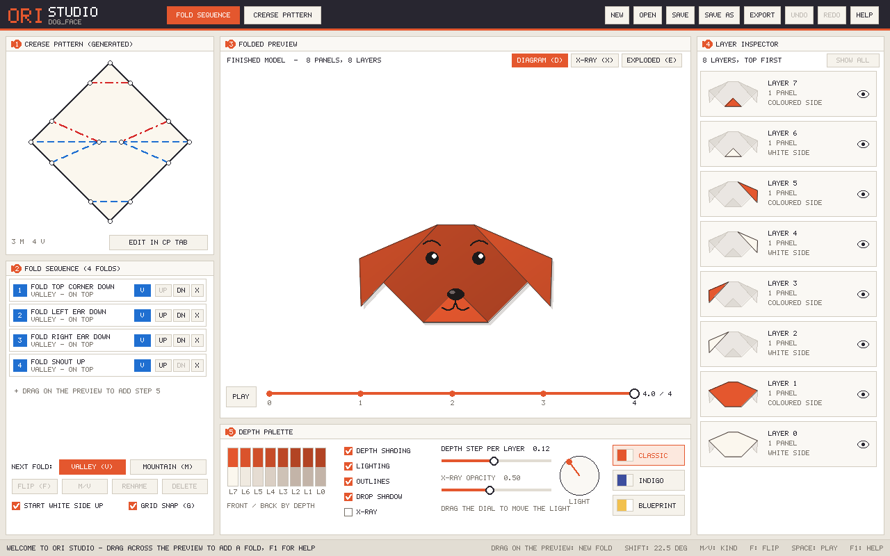
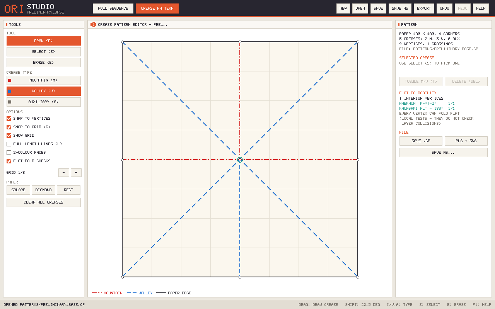
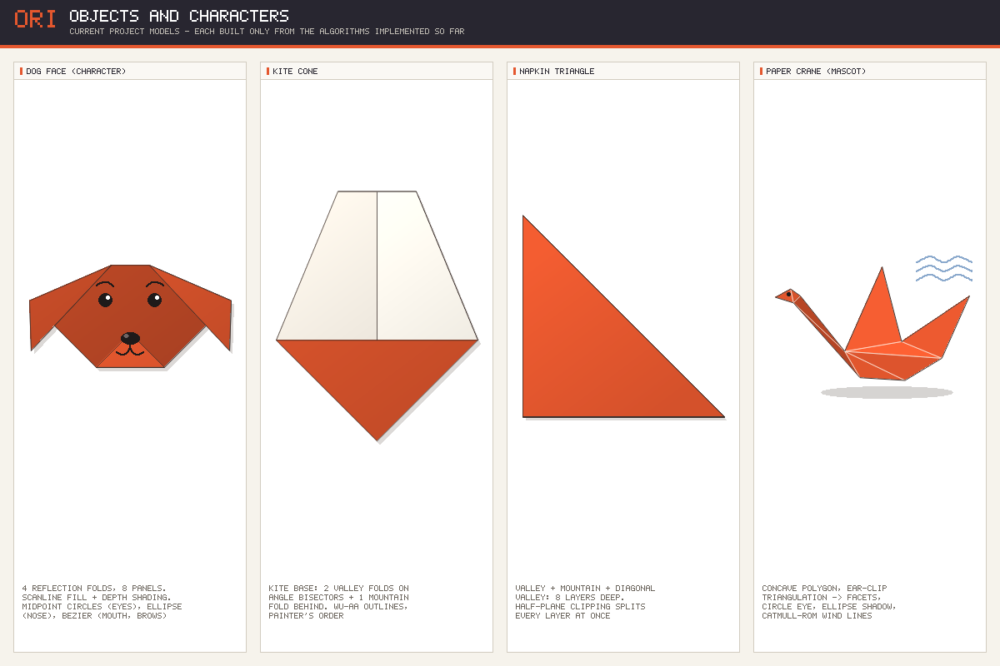
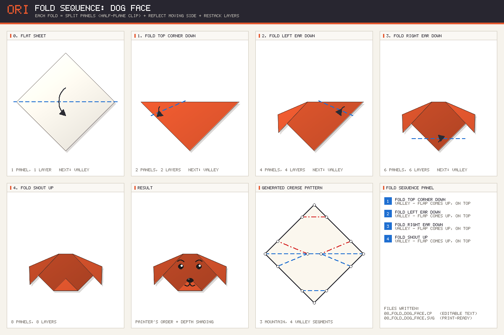
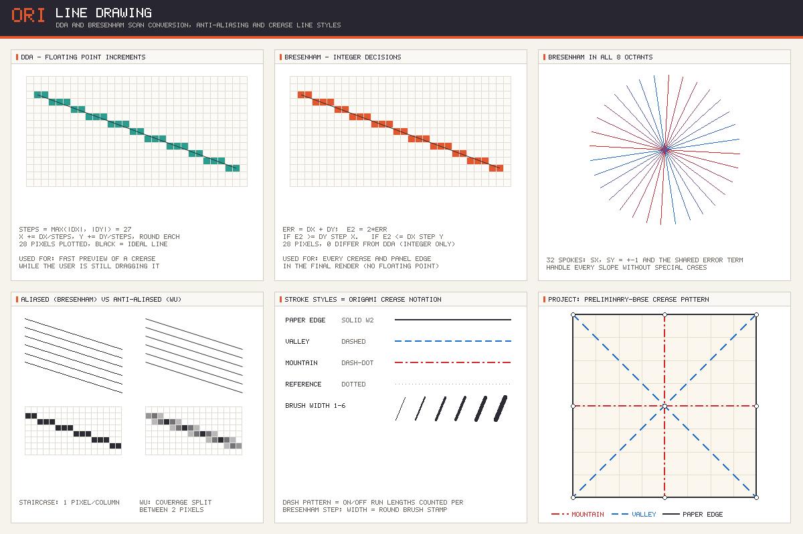
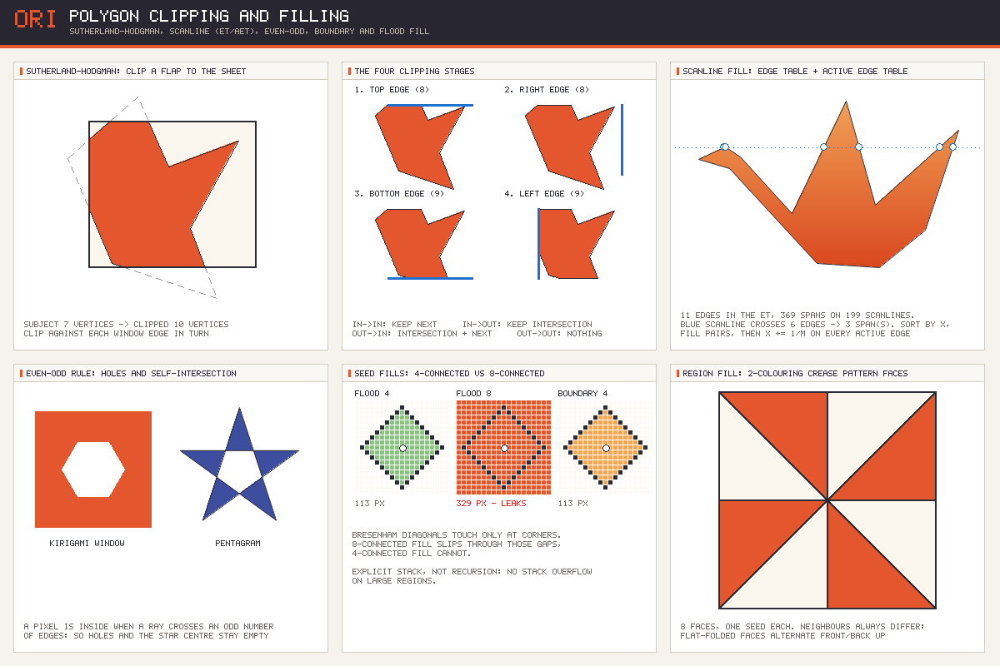
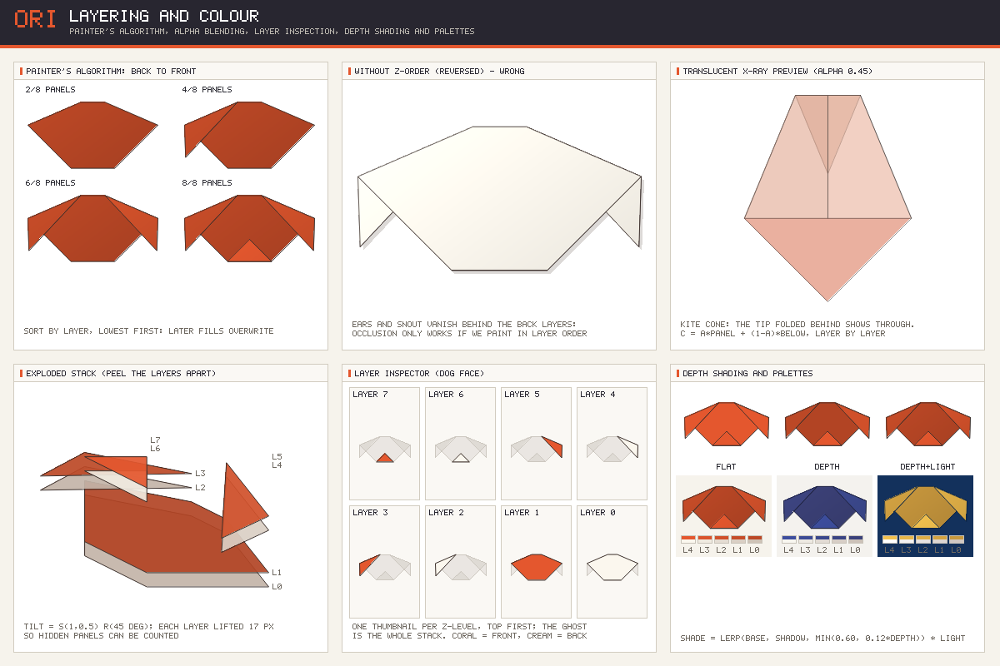
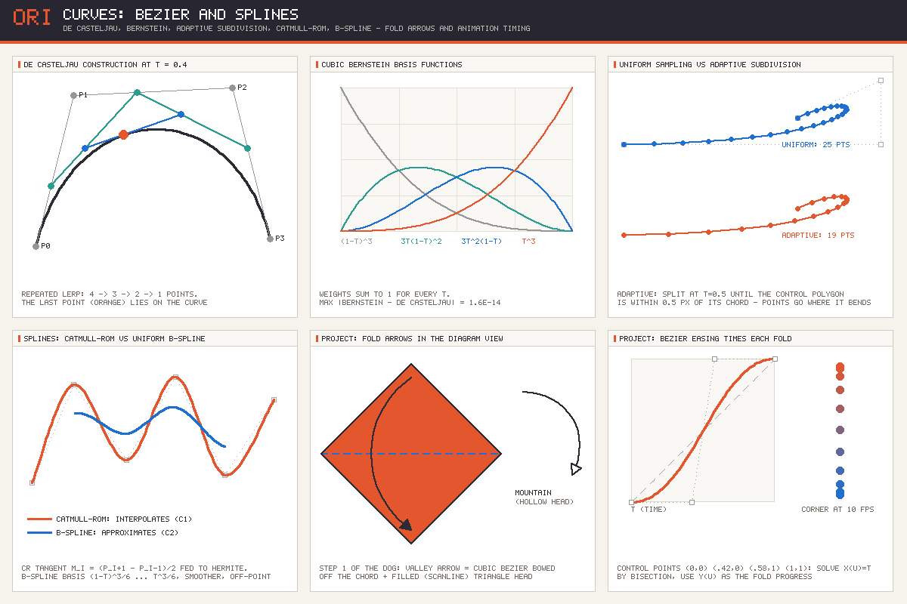

# ORI — A Procedural Origami Folding Studio



**ORI** is a design tool that folds a flat origami **crease pattern** into its folded state using nothing but **composed reflection transformations**, then renders the stacked paper as a layered raster image.

1. **Sketch**: draw a flat crease pattern of straight mountain and valley creases on a paper outline (`.cp` files).
2. **Fold**: each crease is a reflection. Folds compose in sequence to bend the paper (`.ori` fold-sequence files).
3. **Layer**: folded panels are clipped along each crease and z-ordered into a stack.
4. **Export**: the folded result is rasterised and saved as PNG, BMP, PPM, an animated GIF, and the generated crease pattern as `.cp` and print-ready `.svg`.

**Two programs:** **`ori_studio`**, an interactive design studio (draw folds and crease patterns with the mouse, play them back, inspect layers, save, export), and **`ori`**, a command-line tool that renders the evidence sheets and processes files in batches.

> **Pure C++17, no graphics library.** We wrote every pixel-producing algorithm ourselves: line drawing, polygon filling, clipping, circles, ellipses, curves, and the PNG (with our own DEFLATE compressor), BMP, PPM and GIF encoders. The studio uses SDL2 *only* to open a window and read the mouse; every pixel in the window comes from our rasterizer.

---

## Group members and responsibilities (Group 1)

Every file belongs to exactly one member. The full list is in [`scripts/packages.tsv`](scripts/packages.tsv), and each file's header names its owner. Run `ori list` to see who owns each evidence sheet.

| Member | Area | Main folders and files |
|---|---|---|
| **Ray Lukorito** | App shell, studio core and window, image export, build system, CI, docs | `app/`, `studio/Studio.*`, `studio/sdl/`, `src/core/Image.*`, build files, `.github/workflows/`, `scripts/`, `README.md`, `docs/PUSH_PLAN.md` |
| **Mathew Nguithi** | Rasterizer, studio UI toolkit, test framework | `src/raster/Lines.*`, `Fill.*`, `Clipping.*`, `studio/Widgets.*`, demos 01, 02, 04, `tests/TestFramework.h`, `docs/STUDIO.md` |
| **Evans Mwendwa** | Geometry, crease-pattern editor (library and studio tab), file formats | `src/geometry/`, `src/editor/`, `studio/StudioCrease.cpp`, `src/core/Deflate.*`, `patterns/*.cp`, demo 03 |
| **Mohamed Bile** | 2D transformations, fold engine, fold diagrams, studio fold tool | `src/math/`, `src/fold/`, `studio/StudioFold.cpp`, `patterns/*.ori`, demos 07–10, `docs/ALGORITHMS.md` |
| **Matthew Wachira** | Colour, shading, curves, circles, GIF, studio palette and timeline | `src/curves/`, `src/shading/`, `src/raster/Circle.*`, `src/core/Color.h`, `src/core/GifWriter.*`, `studio/StudioPalette.cpp`, `tests/test_studio.cpp`, demos 05, 06, 13 |
| **Edgar Kareithi** | Layering, models, studio layout, preview, files and dialogs | `src/layering/`, `src/models/`, `src/core/Font.*`, `src/core/Layout.*`, `studio/StudioPreview.cpp`, `StudioFiles.cpp`, `StudioDialogs.cpp`, demo registry, demos 11, 12, 14 |

How the team pushes work, in any order and in roughly equal shares, is described in **[`docs/PUSH_PLAN.md`](docs/PUSH_PLAN.md)**.

## Technologies and tools

* **Language:** C++17, standard library only
* **Build:** GNU Make, CMake (3.14+), or the one-line scripts `build.sh` and `build.bat`
* **Compilers tested:** g++ and clang++, with zero warnings under `-Wall -Wextra -Wpedantic -Wshadow`. MSVC is supported through CMake.
* **Output formats:** PNG (compressed), BMP, PPM, animated GIF, SVG and `.cp`, all written by our own code
* **Window (studio only):** SDL2, used only to show our framebuffer and read input. Without SDL2 everything else still builds.
* **Version control and CI:** Git and GitHub. CI is package-aware: it compiles whatever is present on every push, then once all packages are in it builds and tests on Linux, macOS and Windows and uploads the renders.

## Graphics techniques and algorithms

| Topic | Algorithms | Where | Project use |
|---|---|---|---|
| **Line drawing** | DDA, Bresenham (all octants), Xiaolin Wu anti-aliasing, brush width, dash patterns | `src/raster/Lines.*` | Creases in origami notation (valley dashed, mountain dash-dot) |
| **Line operations** | Segment and line intersection, side-of-line test, projection, distance, reflection, vertex-then-grid snapping | `src/geometry/Line.*`, `src/editor/CreasePattern.*` | Crease vertices, snapping in the editor |
| **Line clipping** | Cohen–Sutherland, Liang–Barsky, Cyrus–Beck (any convex window) | `src/raster/Clipping.*` | Trimming creases to the sheet, including a diamond sheet |
| **Polygons** | Ordered vertex list; shoelace area, centroid, perimeter, convexity, orientation, even-odd point-in-polygon, ear-clipping triangulation, convex hull | `src/geometry/Polygon.*` | Every sheet and folded panel |
| **Polygon clipping** | Sutherland–Hodgman, half-plane split | `src/raster/Clipping.*`, `src/fold/FoldEngine.*` | A fold splits each panel along the crease |
| **Polygon filling** | Scanline with Edge Table / Active Edge Table (even-odd, holes, top-left rule), shaded and alpha fills, 4/8-connected flood fill, boundary fill | `src/raster/Fill.*` | Painting panels, 2-colouring crease-pattern faces |
| **Circles and ellipses** | Midpoint circle (8-way symmetry), midpoint ellipse (two regions), filled, translucent, arcs, rings | `src/raster/Circle.*` | Vertex markers, handles, the dog's eyes and nose |
| **Curves** | Bézier (de Casteljau, Bernstein, adaptive subdivision), Catmull–Rom, uniform cubic B-spline, Hermite, Bézier easing | `src/curves/Curves.*` | Fold arrows, the dog's mouth and brows, animation timing |
| **2D transformations** | Homogeneous 3×3 matrices; reflection across any line by composition `T R S(1,−1) R⁻¹ T⁻¹` (checked against the closed form), inverse, determinant, partial fold `S(1, cos πt)` | `src/math/Mat3.*` | The fold engine |
| **Folding** | Split, reflect, restack (valley on top, mountain underneath), crease generation with M/V per layer, in-progress folds | `src/fold/FoldEngine.*` | Every model, every animation |
| **Layering and colour** | Painter's algorithm, alpha blending (X-ray), depth shading, lighting gradient, exploded view, layer inspector, palettes | `src/layering/`, `src/shading/` | The folded stack |
| **Image encoding** | PNG row filters + DEFLATE (LZ77 + fixed Huffman) + CRC-32/Adler-32; GIF colour cube + Bayer dithering + LZW | `src/core/` | Every exported file |

How each one works is in **[`docs/ALGORITHMS.md`](docs/ALGORITHMS.md)**, with one page per area.

## Repository structure

```
ori-origami-studio/
├── src/                     the library: one folder per module
│   ├── core/       framebuffer, PNG/BMP/PPM, DEFLATE, GIF, colour, font, layout
│   ├── math/       Vec2, Mat3 (homogeneous transforms, reflections)
│   ├── geometry/   Segment, Line, Polygon and their operations
│   ├── raster/     lines, circles/ellipses, fills, clipping
│   ├── curves/     Bézier, splines, fold arrows, easing
│   ├── shading/    palettes, depth shading, lighting
│   ├── editor/     crease pattern model, snapping, .cp/.svg, renderer
│   ├── fold/       fold engine, .ori fold-sequence files
│   ├── layering/   painter's algorithm, X-ray, exploded view, inspector, diagrams
│   └── models/     dog face, kite cone, napkin triangle, crane mascot
├── demos/                   one evidence sheet per technique (owner in each header)
├── app/main.cpp             the `ori` command-line program
├── studio/                  the interactive studio: UI toolkit + one file per region
│   └── sdl/main.cpp         the SDL2 window shell (the only file that touches SDL)
├── tests/                   dependency-free unit tests
├── patterns/                sample crease patterns (.cp) and fold sequences (.ori)
├── docs/                    algorithm notes, push plan, screenshots
├── scripts/                 package manifest and package / CI tools
├── .github/                 CI workflow, issue and PR templates, CODEOWNERS example
├── Makefile  CMakeLists.txt  build.sh  build.bat
```

Dependency order (each layer only uses the ones above it): `core → math → geometry → raster → curves, shading → editor → fold → layering, models → demos → studio, app`.

## The interactive studio

```bash
make                    # also builds build/ori_studio when SDL2 is installed
./build/ori_studio      # opens the studio with the dog-face model
```

* **Fold tab.** Drag across the folded preview to add a fold. The line snaps to corners and midpoints, Shift locks it to 22.5°, and a ghost previews the result. Edit, reorder, flip, rename and delete steps; play and scrub the animation; hide or highlight layers; tune the depth shading, lighting, X-ray and palette.
* **Crease-pattern tab.** Draw mountain, valley and auxiliary creases with snapping, select, toggle and erase them, 2-colour the faces, and see a live **Maekawa / Kawasaki** check at every vertex.
* **Files.** New, open (or drag a file onto the window), save, save as, and export (diagram sheet, PNG, GIF, `.cp`, `.svg`). Undo and redo cover every edit, and closing the window asks before discarding unsaved work.

The full guide is in **[`docs/STUDIO.md`](docs/STUDIO.md)**. Press **F1** in the studio for every shortcut.



## How to compile and run

**Option A: Make (Linux, macOS, Windows with MSYS2)**
```bash
make            # builds build/ori (and build/ori_studio when SDL2 is installed)
make test       # builds and runs the unit tests
./build/ori     # renders every evidence sheet into output/
```

**Option B: CMake (any platform, including Visual Studio)**
```bash
cmake -S . -B build
cmake --build build --config Release
ctest --test-dir build -C Release        # unit tests
./build/ori                              # Windows: build\Release\ori.exe
```

**Option C: no build tool**
```bash
./build.sh          # Linux / macOS (builds the studio too when SDL2 is installed)
build.bat           # Windows with MinGW-w64 g++ on PATH (set SDL2_DIR for the studio)
```

**Using the program**
```bash
./build/ori                     # render all 14 sheets (+ .cp, .svg, .gif) into output/
./build/ori list                # list demos and their owners
./build/ori lines curves dog    # render selected demos only
./build/ori --format bmp        # BMP instead of PNG
./build/ori --out renders       # choose the output folder

./build/ori render patterns/preliminary_base.cp out.png   # render a crease pattern
./build/ori svg patterns/waterbomb_base.cp out.svg        # crease pattern -> print-ready SVG
./build/ori fold patterns/blintz_envelope.ori --out folds # fold a sequence file: step sheet,
                                                          # result, GIF, generated .cp + .svg
./build/ori model dog my_dog.ori                          # start a design from a built-in model
```

Rendering all 14 sheets takes about two seconds.

**Designing your own model.** Copy `patterns/blintz_envelope.ori` and edit it. Each fold line is `a → b` in the current folded coordinates, and the paper to the right of `a → b` on screen moves. `ori fold` reports the panel, layer and crease counts, and any errors with their line numbers. Crease patterns written in ORIPA's numeric `.cp` format can be read too (see `patterns/blintz_oripa.cp`).

## Current progress

**Done:**
* Every technique above implemented from scratch, each on its own labelled evidence sheet that ends with a **project application** panel.
* A **fold engine** that folds three built-in models (dog face, kite cone, napkin triangle) and any `.ori` sequence through valley and mountain folds. It produces the crease pattern those folds create (mountain/valley assigned per layer) and exports it as `.cp` and `.svg`.
* **Objects and characters:** the dog face (circle eyes, ellipse nose, Bézier mouth and brows), the kite cone, the napkin triangle and a faceted paper-crane mascot.
* **Fold animation** with eased partial-fold matrices. The layer order stays physically correct while a flap swings, and the result is exported as a frame sheet and an animated **GIF**.
* **Studio mock-up** showing the 5 planned interface regions, drawn from live model data.
* **Compressed PNG output** with our own DEFLATE. A sheet is about 50 KB, down from 2.9 MB.
* **The interactive studio** (`ori_studio`) with all five designed regions plus a crease-pattern editor, undo/redo, file handling and export.
* **71 unit tests, 13,992 checks.** 13 of these drive the studio like a user: drags, button clicks, keys, typing, saving and reopening files. These include Cohen–Sutherland, Liang–Barsky and Cyrus–Beck agreeing on 500 random segments; composed and closed-form reflections being equal; folded panels tiling the sheet; shared polygon edges never painted twice; and our PNGs decoding pixel-exactly with an inflater written in the tests.

## Known limitations

* **The studio needs SDL2** for its window. `ori` and the tests do not. On Windows the studio is built with `build.bat` and `SDL2_DIR`; the CI builds it on Linux and macOS.
* **Crease patterns cannot be folded directly.** The studio folds *fold sequences*. Folding an arbitrary crease pattern would need a flat-folding solver, which is out of scope.
* **Simple folds only.** A fold moves *every* layer on the moving side of the crease. Folding only the top flap (reverse, squash and petal folds) is not supported.
* **No collision or flat-foldability checks.** Self-intersection and Maekawa/Kawasaki checks are out of scope, as stated in the proposal.
* **GIF colour.** GIF export uses a fixed 252-colour cube with ordered dithering, so gradients show a fine dither pattern.
* **PNG compression** uses the fixed Huffman table only (no dynamic Huffman), so files are larger than zlib's best.
* **Text.** The built-in 5×7 bitmap font is upper-case only, with no accents.

## More documentation

* [`docs/ALGORITHMS.md`](docs/ALGORITHMS.md): how each algorithm works and where to find it, one page per area. Useful for the viva.
* [`docs/STUDIO.md`](docs/STUDIO.md): the studio user guide.
* [`docs/PUSH_PLAN.md`](docs/PUSH_PLAN.md): how each member pushes their package.
* `ORI_Checkpoint_Evidence (1).pdf` and `ori-origami-studio.pptx`: the checkpoint evidence and the proposal slides.

## Screenshots

| | |
|---|---|
|  |  |
|  |  |
|  |  |

The animated fold is [`docs/screenshots/13_fold_dog_face.gif`](docs/screenshots/13_fold_dog_face.gif).
