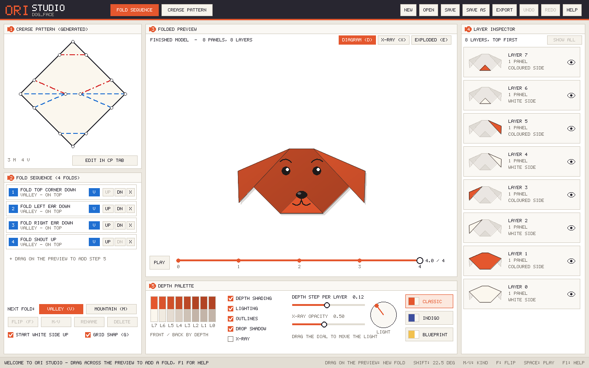

# ORI Studio: user guide

`ori_studio` is the interactive design studio. It opens a window with the five regions from the original design (crease editor, fold sequence, folded preview, layer inspector and depth palette) and a second tab for drawing crease patterns.

Every pixel in the window is drawn by ORI's own rasterizer into an `ori::Image`. SDL2 is used only to open the window, read the mouse and keyboard, and show the finished frame.



## Building and starting it

SDL2 has to be installed:

| System | Command |
|---|---|
| Arch / Omarchy | `sudo pacman -S sdl2` |
| Ubuntu / Debian | `sudo apt install libsdl2-dev` |
| macOS | `brew install sdl2` |
| Windows (MinGW) | unpack the SDL2 MinGW development package, then `set SDL2_DIR=...` before `build.bat` |

```bash
make                         # builds build/ori and, when SDL2 is found, build/ori_studio
./build/ori_studio           # starts with the dog-face model
./build/ori_studio patterns/blintz_envelope.ori      # open a fold sequence
./build/ori_studio patterns/preliminary_base.cp      # open a crease pattern
./build/ori_studio --scale 2                         # bigger UI (or Ctrl + / Ctrl -)
./build/ori_studio --screenshot shot.png             # render one frame without a window
```

CMake builds the `ori_studio` target too. If SDL2 is missing, everything else still builds and the studio is skipped with a message.

## The fold-sequence tab

This tab is where you design a model fold by fold.

1. **Start.** Press **NEW** and pick a blank square, diamond or rectangle, or start from the dog face, kite cone or napkin triangle.
2. **Fold.** Drag a line across the **folded preview**. The paper to the **right** of your drag (as you look at the screen) folds over the line.
   * The line snaps to panel corners and edge midpoints (shown by an orange ring), then to the grid (**G** turns grid snapping on and off).
   * Hold **Shift** to lock the line to multiples of 22.5°, the angles of the classic bases.
   * While you drag, a see-through ghost shows the result and an arrow shows which flap moves.
   * **V** / **M** choose valley (the flap comes up on top) or mountain (it goes behind) for the next fold.
3. **Edit steps** in the **fold sequence** list. Click a step to select it; the preview then shows the model just before that step, with the step's crease and arrow.

   | Action | Key or control |
   |---|---|
   | Change valley ↔ mountain | the **V/M** badge, or **M**/**V** |
   | Make the other side move | **FLIP** (**F**) |
   | Move a step | **UP** / **DN**, or **[** / **]** |
   | Delete a step | **X**, **DELETE** or **Del** |
   | Rename a step | double-click, **RENAME** or **F2** |
4. **Insert folds** anywhere. Move the timeline to an earlier step and draw. The new fold is inserted there, and the later steps then fold the new shape.
5. **Play.** **PLAY** (or **Space**) animates the whole sequence with eased partial folds. Drag along the timeline to scrub through a fold in progress. **←** / **→** step back and forward.
6. **Inspect.** In the **layer inspector**, click a layer to outline it in the preview and click the eye to hide it. The **depth palette** controls depth shading (and its step per layer), lighting (drag the dial to move the light), outlines, the drop shadow, X-ray opacity and the colour palette. **D**, **X** and **E** toggle diagram arrows, X-ray and the exploded view.
7. **Crease pattern.** Region 1 shows the crease pattern your folds leave on the sheet, with the creases from the selected step highlighted. **EDIT IN CP TAB** copies it into the crease-pattern editor.

## The crease-pattern tab

| Tool | Use |
|---|---|
| **DRAW** (D) | Drag to draw a crease. **M** / **V** / **A** pick mountain, valley or auxiliary. Snaps to vertices first, then to the grid. **Shift** locks to 22.5°. **L** makes full-length lines that run edge to edge. |
| **SELECT** (S) | Click a crease. **T** toggles M/V, **Del** deletes it. The info panel shows its length, angle and end points. |
| **ERASE** (E) | Click a crease to remove it. |

* **Right-click** any crease to toggle it between mountain and valley, whatever tool is active.
* The grid can be **1/2 to 1/32** of the paper (**+** / **−**). The paper can be square, diamond or a 2:1 rectangle; changing it trims the creases to the new sheet.
* **2-colour faces** fills the faces alternately using the flood-fill algorithm.
* **Flat-fold checks** test every interior vertex for **Maekawa** (|M − V| = 2) and **Kawasaki** (alternate angles add up to 180°). Green rings pass and red rings fail. These are local tests: they do not detect layers colliding.

## Files

| Action | Key | What it does |
|---|---|---|
| NEW | Ctrl+N | Blank paper or a built-in model |
| OPEN | Ctrl+O | Lists the `.ori` and `.cp` files in `patterns/`, `designs/` and the current folder. You can also **drag a file onto the window**. |
| SAVE / SAVE AS | Ctrl+S / Ctrl+Shift+S | `.ori` from the fold tab, `.cp` from the crease tab. New files go to `designs/` unless you type a folder. |
| EXPORT | Ctrl+E | Fold tab: `NAME_steps.png` (diagram sheet), `NAME.png`, `NAME.gif`, `NAME.cp` and `NAME.svg`. Crease tab: `NAME.png` and `NAME.svg`. Everything goes into `designs/`. |
| UNDO / REDO | Ctrl+Z / Ctrl+Y | Every edit, including NEW and opening a file, can be undone |

The window title shows `*` while there are unsaved changes. Closing the window then asks whether to save, discard or cancel. **F1** opens the full list of shortcuts, and **Tab** switches between the two tabs.

## How it is built (for the team)

The studio is an **immediate-mode GUI**. Each frame, the panels call `ui.button(...)`, `ui.slider(...)` and so on, and each call both draws the widget and reports what the mouse or keyboard did to it. There are no widget objects and no callbacks.

| File | Owner | Part |
|---|---|---|
| `studio/Widgets.*` | Mathew | UI toolkit: buttons, toggles, sliders, text fields, scroll lists, clipping |
| `studio/Studio.*`, `studio/sdl/main.cpp` | Ray | Frame loop, layout, top bar, undo/redo, shortcuts, SDL2 window shell |
| `studio/StudioFold.cpp` | Mohamed | Drawing folds, snapping, the sequence list, the generated crease pattern |
| `studio/StudioPreview.cpp` | Edgar | Folded preview and layer inspector |
| `studio/StudioFiles.cpp`, `studio/StudioDialogs.cpp` | Edgar | Open / save / export, and the dialogs |
| `studio/StudioPalette.cpp` | Matthew | Depth palette, light dial, timeline and playback |
| `studio/StudioCrease.cpp` | Evans | The crease-pattern editor tab and the flat-foldability checks |

`Studio` knows nothing about SDL, so `tests/test_studio.cpp` drives it exactly as the window does. It sends mouse drags, clicks on named buttons, key presses and typed text, then checks the result: folds added, snapping, undo, playback, saving and reopening files, exports, dialogs, and the quit prompt.
